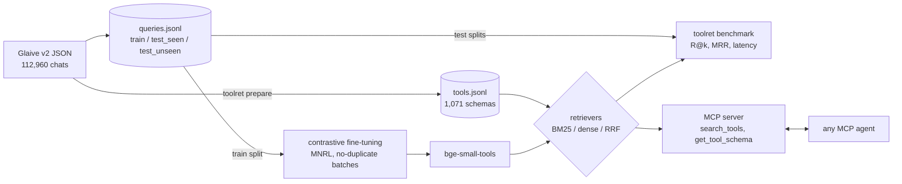

# toolret: finding the right tool among 1,000+ for an LLM agent, served over MCP

[](https://github.com/Adversitas/agent-tool-retrieval/actions/workflows/ci.yml)

An agent with three tools can read all their schemas in its prompt. An agent platform with a
thousand tools cannot: the schemas alone would cost about **84,000 tokens per request**, and
the model's tool choice degrades long before the context is full. The usual answer is *tool
retrieval*: index the tools, retrieve the few that fit the request, and show the model only
those.

This project measures how well that works on real function-calling data, and ships the result
as an **MCP server** any agent (Claude, LangGraph, an IDE) can plug into.

- **Data**: [Glaive function-calling v2](https://huggingface.co/datasets/glaiveai/glaive-function-calling-v2)
  (Apache-2.0, 112,960 conversations). Every tool schema found in a system prompt goes into one
  shared registry (**1,071 distinct tools**), and the first user message of each chat is a
  query whose gold label is the tool the assistant actually called.
- **Split by tool, not by query**: 30 % of tool names never appear in training. The *unseen*
  test set measures what happens when someone registers a new tool after the retriever was
  trained: it has to work without retraining.
- **Retrievers**: BM25 (from scratch), dense `BAAI/bge-small-en-v1.5`, Reciprocal Rank Fusion
  of both, and the same bi-encoder **fine-tuned contrastively** on (query, called tool) pairs.

## Results

`toolret benchmark` on 1,747 test queries for tools seen in training and 767 for unseen tools
(at most 8 queries per tool so popular tools don't dominate). Full table:
[`reports/results.md`](reports/results.md).

| Retriever | Tools | R@1 | R@3 | R@5 | R@10 | MRR | ms/query (CPU) |
|---|---|---|---|---|---|---|---|
| BM25 | seen | 0.417 | 0.634 | 0.735 | 0.849 | 0.555 | 3 |
| BM25 | **unseen** | 0.416 | 0.635 | 0.724 | 0.842 | 0.555 | 3 |
| bge-small (base) | seen | 0.449 | 0.715 | 0.825 | 0.905 | 0.607 | 70 |
| bge-small (base) | **unseen** | 0.372 | 0.686 | 0.801 | 0.892 | 0.556 | 75 |
| Hybrid BM25 + base (RRF) | **unseen** | 0.375 | 0.691 | 0.819 | 0.904 | 0.567 | 83 |
| **bge-small fine-tuned** | seen | **0.597** | **0.846** | **0.918** | **0.970** | **0.738** | 76 |
| **bge-small fine-tuned** | **unseen** | **0.507** | **0.802** | **0.892** | **0.960** | **0.669** | 79 |
| Hybrid BM25 + fine-tuned | **unseen** | 0.455 | 0.751 | 0.842 | 0.917 | 0.626 | 87 |

Prompt budget: the 1,071 schemas weigh about **84,400 tokens**; the top 5 about **390**
(4 characters per token estimate), a 200x reduction, with the right tool in that top 5 for
89 % of requests about tools the retriever never saw in training.

What the numbers say:

- **Fine-tuning pays, and it generalises to new tools.** One epoch (71 steps, about 2,300
  pairs, a few minutes on a laptop CPU) lifts R@5 on *unseen* tools from 0.80 to 0.89 and R@1
  from 0.37 to 0.51. The model learns how users phrase requests ("I need to…", amounts,
  places), not the specific tools, so registering a new tool does not need retraining.
- **Hybrid fusion is not automatically better.** RRF helps the base model a little at R@5
  (+1.8 points on unseen tools) but *hurts* the fine-tuned one (-5 points): once the dense
  ranking is good, BM25 mostly adds noise from shared words like "calculate" or "number".
  Hybrid has to be validated, not assumed.
- **Strict R@1 understates quality, because the registry has duplicates.** 65 % of the
  fine-tuned model's top-1 misses on unseen tools return a tool that shares the gold tool's
  main concept word. Typical "errors": `calculate_bmi` for `calculate_body_mass_index`,
  `get_news` for `get_latest_news`, `calculate_mortgage_payment` for `calculate_mortgage`.
  An agent would succeed with most of these, and on a real platform the fix is registry
  hygiene (deduplicating tools), not a bigger model.
- **BM25 is the strongest zero-training baseline at R@1** on unseen tools (0.416 vs 0.372 for
  the base dense model) and 25x faster, which makes it a sensible fallback when the embedding
  service is down.

## Architecture



| Module | Role |
|---|---|
| [`data.py`](src/toolret/data.py) | Parses Glaive system prompts (robust JSON scanning), extracts the called tool, builds the registry and the by-tool splits. |
| [`retrievers.py`](src/toolret/retrievers.py) | BM25 implemented from scratch, sentence-transformers bi-encoder, Reciprocal Rank Fusion. |
| [`finetune.py`](src/toolret/finetune.py) | Multiple-negatives ranking loss with batches packed so a tool never appears twice (a duplicate would be a false negative). |
| [`evaluate.py`](src/toolret/evaluate.py) | Recall@k, MRR, macro recall per tool, latency, prompt-budget estimate. Ties are counted against the gold tool. |
| [`server.py`](src/toolret/server.py) | MCP server (official `mcp` SDK) exposing `search_tools` and `get_tool_schema`. |

The agent-side pattern is "search, then load": the model calls `search_tools("convert 100
USD to EUR")`, gets five names with descriptions, then `get_tool_schema("convert_currency")`
for the one it picks, and only then calls the real tool. Its context holds two meta-tools
instead of a thousand schemas.

## How to run

```bash
pip install -e ".[embeddings,dev]"
toolret prepare                 # download Glaive v2 (271 MB) and rebuild data/*.jsonl
toolret finetune                # about 5 minutes on CPU -> models/bge-small-tools
toolret benchmark               # all retrievers, writes reports/benchmark.json
toolret report                  # reports/results.md
toolret search "what's the weather like in Lyon tomorrow" -k 3
toolret serve                   # MCP server over stdio
```

To use it from an MCP client, register the command, for example:

```json
{"mcpServers": {"tool-registry": {"command": "toolret", "args": ["serve", "--retriever", "bm25"]}}}
```

The processed splits (`data/tools.jsonl`, `data/queries.jsonl`) are committed, so the BM25
benchmark runs without any download: `toolret benchmark --bm25-only`. CI runs it on every push,
along with ruff and the test suite (the dense retriever is tested with a deterministic fake
encoder, the MCP server through its real `list_tools` / `call_tool` interface).

## Limitations

- Glaive is synthetic (generated conversations), and its user turns are short and explicit.
  Real requests are vaguer and multi-step; expect lower absolute numbers.
- Labels are strict tool *names*. Because the registry contains functional duplicates, R@1 is
  a lower bound on how often an agent would pick a workable tool.
- One fine-tuning run (seed 0) is reported; the effect is large compared with seed noise on
  767 queries, but no confidence interval is given.
- Retrieval only: the end-to-end effect on the LLM's final tool call and arguments is not
  measured here.

## En bref (FR)

Quand un agent IA dispose de plus de 1 000 outils, impossible de tous les mettre dans le prompt
(environ 84 000 tokens). Ce projet mesure la **recherche d'outils** sur des données réelles de
function calling (Glaive v2, 1 071 outils) : BM25, embeddings bge-small, fusion hybride et un
modèle **fine-tuné par apprentissage contrastif**. Sur des outils jamais vus à l'entraînement,
le fine-tuning fait passer le bon outil dans le top 5 de 80 % à **89 %** des requêtes, et le
prompt passe de 84 000 à environ 400 tokens. La fusion hybride, souvent présentée comme
toujours meilleure, dégrade ici le modèle fine-tuné. Le tout est exposé via un **serveur MCP**
(`search_tools`, `get_tool_schema`) utilisable par n'importe quel agent compatible MCP.

## License

MIT for the code. The committed splits are derived from Glaive function-calling v2
(Apache-2.0, glaiveai).
